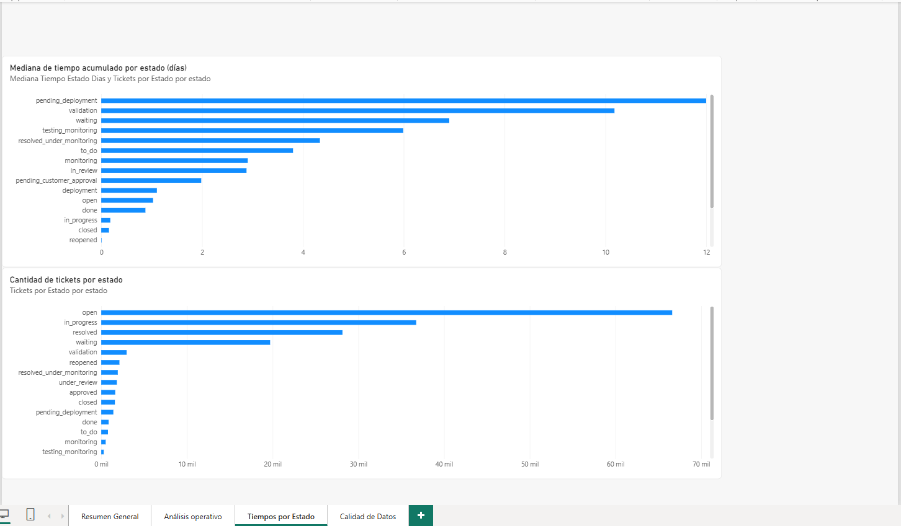
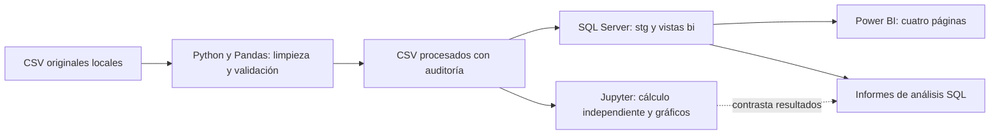

# HelpDesk Analytics

Análisis de **66.691 tickets y 257.508 eventos históricos de soporte** para explorar tiempos de resolución, reaperturas y calidad de datos. El proyecto conecta la preparación de datos con consultas analíticas y un dashboard de Power BI, con resultados reproducibles y sus limitaciones documentadas.

**Tecnologías:** Python, Pandas, NumPy, Matplotlib, Jupyter, SQL Server y Power BI.

**66.691 tickets · 257.508 eventos · 2 notebooks ejecutados · 4 páginas de Power BI**

El proyecto describe una extracción histórica: no acredita mejoras empresariales implantadas, satisfacción del usuario ni cumplimiento de SLA. El corte observado es el **14 de marzo de 2023, 14:19:32 UTC**; no representa la operación actual de un HelpDesk.

## Recorrido del portafolio

- [Dashboard Power BI](#dashboard-power-bi): vista previa y cuatro páginas con capturas reales.
- [Hallazgos principales](#hallazgos-principales) e [informe final](reports/final_analysis.md): resultados, poblaciones e interpretación.
- [Arquitectura](#arquitectura-del-proyecto): flujo de datos, granularidades y consultas SQL.
- [Análisis con Jupyter](#análisis-con-jupyter): dos notebooks ejecutados, gráficos y controles.
- [Inicio rápido](#inicio-rápido) e [instalación y reproducción](#instalación-y-reproducción).
- [Pruebas y validaciones](#pruebas-y-estado-de-verificación).
- [Fuente y licencias](#fuente-de-datos-y-atribución).
- [Historial técnico](docs/project_history.md): documentación completa de las fases 3, 4 y 6.

## Dashboard Power BI

El archivo local `powerbi/HelpDesk_Analytics.pbix` contiene cuatro páginas. Se comprobó su estructura; esa revisión no constituye una validación de cada medida DAX ni del comportamiento de los filtros en Desktop. El PBIX está excluido de Git porque puede contener datos importados y configuración de conexiones.

Las cuatro capturas reales se conservan sin modificaciones en `powerbi/screenshots/`. Se verificaron su formato PNG, la información visible y las rutas relativas; no están excluidas por `.gitignore`. Las imágenes muestran el estado visual del dashboard, con sus formatos abreviados y redondeos. Para consultar cifras exactas, poblaciones y denominadores, utilizar el [informe final](reports/final_analysis.md).

### Resumen General

Presenta el volumen de tickets, las resoluciones `Done`, las reaperturas, los indicadores calendario y la prioridad desconocida. Incluye distribuciones por prioridad y resolución, evolución temporal y filtro de prioridad.


### Análisis Operativo

Compara la mediana de resolución y las reaperturas por prioridad, diferenciando cantidades y porcentajes. Los filtros de año de creación y tipo permiten explorar segmentos; las diferencias observadas no prueban causalidad.


### Tiempos por Estado

Muestra la mediana del tiempo acumulado por estado y la cantidad de tickets que lo recorrieron. Ambas magnitudes responden a preguntas distintas: una duración acumulada no equivale a horas trabajadas.



### Calidad de Datos

Resume los tickets señalados, duraciones negativas y discrepancias de tiempo, e incluye una distribución de anomalías y una tabla de detalle. Los indicadores pueden solaparse; sus conteos no deben sumarse como tickets únicos.


La revisión visual no detectó nombres personales, correos, credenciales ni detalles de conexión. La tabla de Calidad de Datos conserva IDs de registros y códigos de proyecto enmascarados del dataset público; no son identidades de usuarios ni claves de acceso. Las capturas no sustituyen la auditoría de las medidas y filtros del modelo.

## Hallazgos principales

| Tema | Resultado verificado | Interpretación y población |
|---|---|---|
| Prioridades | 33.965 `unknown`: **50,93 %** | Sobre 66.691 tickets. No equivale a prioridad baja |
| Tiempo calendario de `Done` | **35,87 días** de mediana y **2.858,35 días** de P90 | 62.034 elegibles; incluye esperas y períodos no laborales |
| Sensibilidad temporal de `Done` | Desde 2016: **9,08 días** de mediana y **103,06 días** de P90 | 38.747 elegibles; aparta 23.287 de la base. Son poblaciones distintas, sin inferencia causal |
| Reaperturas | **2.123 tickets**, 2.364 visitas agregadas y 2.325 eventos | 3,1833 % sobre 66.691 agregados conocidos; la tasa por eventos usa 66.650 tickets con historial |
| Calidad | **450 tickets señalados**, 55 con negativos y 374 con discrepancia de duración | 44 combinan negativos y discrepancia; los flags se solapan |
| Duración por estado | `pending_deployment`: mediana no negativa de **12,00 días**, n=1.413 | `open` tiene la mayor suma positiva acumulada. Los rankings no prueban cuellos de botella |

Hay **39 tickets** con conteos de reapertura distintos entre fuentes: 38 con más visitas agregadas y uno con más eventos. La diferencia neta es 39 y la suma absoluta, 41. No son el mismo indicador.

Fuentes de cifras y definiciones: [exploración SQL](reports/sql_exploration.md), [análisis avanzado SQL](reports/sql_advanced_analysis.md), [calidad](reports/data_quality.md) y [conclusiones](reports/final_analysis.md). `Done` es una resolución registrada, no satisfacción; tiempo calendario y duración acumulada no son horas trabajadas.

## Arquitectura del proyecto

El flujo principal es **CSV → Python → SQL Server → Power BI**. Python produce CSV procesados con trazabilidad; la carga SQL preserva los datos y los flags; las vistas `bi` separan granularidades para Power BI.



**Jupyter complementa el flujo:** lee los CSV procesados, explica operaciones y contrasta resultados con los informes SQL. Los notebooks no conectan al servidor, no duplican el ETL ni modifican Power BI.

| Capa | Granularidad y evidencia |
|---|---|
| Tickets | Una fila por ticket; 66.691 filas |
| Historial | Una fila por evento; 257.508 filas |
| Estados | Una pareja ticket–estado; 1.333.820 filas para 20 estados |
| SQL | [Consultas](sql/) y [modelo analítico](reports/bi_data_model.md), con claves y denominadores |
| Presentación | Notebooks, informe final y páginas de Power BI |

Las relaciones de Power BI parten de tickets hacia eventos y estados, con filtro único. Aplanar las tablas hijas multiplicaría registros. Los detalles de precisión, fechas UTC y filtros están en [la guía del modelo](powerbi/model_setup.md).

Consultas principales: [exploración](sql/03_exploratory_analysis.sql), [análisis avanzado](sql/04_advanced_analysis.sql) y [vistas para Power BI](sql/05_bi_views.sql).

## Estructura del proyecto

```text
data/                    # CSV locales excluidos; FEATURES.md y marcadores públicos
src/                     # Limpieza, carga, conexión y validación analítica
sql/                     # DDL, exploración, análisis avanzado y vistas bi
notebooks/               # Dos notebooks ejecutados y su guía
powerbi/                 # Guía del modelo y capturas reales en screenshots/; PBIX local excluido
reports/                 # Evidencia histórica, informe final y checklist
docs/                    # Historial técnico completo del proyecto
reports/figures/         # Recursos gráficos complementarios
tests/                   # Pruebas locales y cuatro pruebas SQL opcionales
requirements.txt         # Dependencias de uso y notebooks
requirements-dev.txt     # Dependencias de desarrollo
.env.example             # Plantilla pública sin secretos
```

## Análisis con Jupyter

| Notebook | Contenido | Entrega ejecutada |
|---|---|---|
| [01 · Análisis exploratorio](notebooks/01_exploratory_analysis.ipynb) | Dimensiones, ausencias, anomalías, prioridades, resoluciones y evolución temporal | 43 celdas; 4 figuras; 24 controles |
| [02 · Análisis avanzado](notebooks/02_advanced_analysis.ipynb) | Mediana/P90, cohortes, prioridad y tipo, reaperturas, estados y sensibilidad | 42 celdas; 7 figuras; 47 controles |

Las salidas guardadas son compactas y revisables en GitHub. Los datos no se incluyen; para ejecutar localmente deben estar disponibles los CSV procesados y las referencias documentales. No hace falta ejecutar el primero para utilizar el segundo.

La [guía de notebooks](notebooks/README.md) contiene los comandos completos, selección de `.venv` en VS Code, ejecución sin interfaz, variables UTF-8 y configuración local de Jupyter. Las tablas SQL y los cálculos independientes de Pandas/NumPy permiten comprobar los indicadores sin credenciales.

## Inicio rápido

Necesitas Git y Python 3.11 o superior. En PowerShell:

```powershell
git clone https://github.com/TheDanielrity/helpdesk-analytics.git
cd helpdesk-analytics
python -m venv .venv
.\.venv\Scripts\python.exe -m pip install -r requirements.txt
.\.venv\Scripts\python.exe -m ipykernel install --sys-prefix --name helpdesk-analytics --display-name "Python (.venv HelpDesk Analytics)"
```

Los **CSV se obtienen por separado** de la [fuente del dataset](https://data.mendeley.com/datasets/btm76zndnt/3); no vienen incluidos al clonar. Antes de ejecutar los notebooks, prepara `data/processed/issues_clean.csv` y `data/processed/issues_change_history_clean.csv` siguiendo [los pasos de datos](#2-obtener-y-preparar-los-datos).

Abre [el notebook exploratorio](notebooks/01_exploratory_analysis.ipynb) o [el avanzado](notebooks/02_advanced_analysis.ipynb) en VS Code con las extensiones Python y Jupyter. Selecciona el kernel **Python (.venv HelpDesk Analytics)** y utiliza **Reiniciar kernel** y **Ejecutar todo / Run All**. Los notebooks no requieren conexión a SQL Server.

Para ejecutar desde terminal o adaptar las rutas a Linux/macOS, consulta [la guía de notebooks](notebooks/README.md#ejecutar-sin-interfaz). La sección siguiente conserva los requisitos y los pasos detallados de reproducción.

## Instalación y reproducción

### 1. Crear el entorno

Se requiere **Python 3.11 o superior**. El entorno comprobado utiliza Python 3.13.2. Desde la raíz, en PowerShell, crear `.venv` si aún no existe:

```powershell
python --version
python -m venv .venv
.\.venv\Scripts\python.exe -m pip install -r requirements.txt
.\.venv\Scripts\python.exe -m ipykernel install --sys-prefix --name helpdesk-analytics --display-name "Python (.venv HelpDesk Analytics)"
```

En Linux/macOS, utilizar `python3 -m venv .venv` y `.venv/bin/python` en lugar del ejecutable de Windows. No se depende de activar el entorno ni de modificar la política de ejecución de PowerShell.

`requirements.txt` incluye las dependencias utilizadas: Pandas, NumPy, Matplotlib, pyodbc, python-dotenv, ipykernel, nbformat y nbclient. `IPython.display` está disponible mediante ipykernel. `requirements-dev.txt` añade SQLFluff para pruebas de sintaxis T-SQL. Los rangos de versiones no son un archivo de bloqueo exacto; los notebooks muestran las versiones de ejecución.

### 2. Obtener y preparar los datos

Descargar manualmente de la fuente atribuida los archivos `issues.csv` e `issues_change_history.csv` y colocarlos en `data/raw/`. Los CSV no se descargan ni se incluyen automáticamente en el repositorio. El diccionario público `data/FEATURES.md` sí se incluye.

Para una reproducción nueva del procesamiento:

```powershell
.\.venv\Scripts\python.exe src/inspect_data.py data/raw/issues.csv
.\.venv\Scripts\python.exe src/clean_data.py
```

La limpieza genera los CSV en `data/processed/` y el informe de calidad. Preserva filas, nulos, `unknown`, negativos y trazabilidad; no imputa datos para mejorar indicadores. Si ya se dispone de los archivos procesados validados, pasar directamente a los notebooks. En esta revisión de publicación no se regeneraron los datos.

### 3. Ejecutar los notebooks sin SQL Server

Abrir la carpeta en VS Code con las extensiones Python y Jupyter, seleccionar **Python (.venv HelpDesk Analytics)**, reiniciar el kernel y utilizar **Ejecutar todo / Run All**. Los comandos de terminal y la configuración UTF-8 se encuentran en [notebooks/README.md](notebooks/README.md#ejecutar-sin-interfaz).

### 4. Reproducir la capa SQL en un entorno nuevo

SQL Server y su controlador ODBC se instalan por separado; `pip` no instala el motor ni el driver. Configurar credenciales sólo en `.env` local o en el entorno. La plantilla contiene valores de ejemplo y campos de autenticación vacíos:

```powershell
if (-not (Test-Path -LiteralPath .env)) { Copy-Item .env.example .env }
# Completar .env localmente; no guardar contraseñas en notebooks ni consultas.
.\.venv\Scripts\python.exe src/sql_connection.py
```

Para una base nueva con destino vacío, el cargador puede crear el esquema y validar la importación:

```powershell
.\.venv\Scripts\python.exe -m src.load_to_sql --create-schema
.\.venv\Scripts\python.exe -m src.bi_views --apply
```

Estos dos comandos crean objetos o cargan datos y **no forman parte de la revisión de publicación**. El cargador rechaza tablas pobladas e incompatibles; no usarlo como recarga del entorno ya implementado. La configuración TLS del ejemplo corresponde a desarrollo local y debe ajustarse al servidor de destino.

Las consultas de `sql/03_exploratory_analysis.sql` y `sql/04_advanced_analysis.sql` son de lectura. Sus ejecutores `src.explore_sql` y `src.advanced_sql` regeneran artefactos SQL/Markdown locales al contrastar con CSV. Los resultados de las ejecuciones previas se conservan en `reports/`.

## Pruebas y estado de verificación

Las validaciones locales, de notebooks y de integración SQL están completadas. Los resultados corresponden a las ejecuciones documentadas; las cuatro pruebas SQL requieren activación explícita para repetirse.

**Revisión del 15 de noviembre de 2026:** 35 pruebas descubiertas; **31 superadas y 4 de integración omitidas por defecto**. Los notebooks se verifican aparte con sus 24 y 47 controles. Los tests usan casos sintéticos y datos locales para revisar limpieza, claves, conversiones exactas, carga parametrizada, transacciones simuladas, DDL y vistas.

La integración real de sólo lectura se repitió el 15 de noviembre de 2026 fuera del entorno restringido: **4 pruebas ejecutadas y superadas; 0 fallidas, errores u omitidas**. Las tres vistas `bi` resultaron accesibles, con sus definiciones intactas y los conteos esperados. El intento anterior con `SQLSTATE 08001` y el alcance de la reverificación se conservan en [el checklist](reports/publication_checklist.md#reverificación-sql-server--15-de-noviembre-de-2026).

### Repetir las pruebas locales

Instalar las dependencias de desarrollo y ejecutar:

```powershell
.\.venv\Scripts\python.exe -m pip install -r requirements-dev.txt
.\.venv\Scripts\python.exe -m unittest discover -s tests -v
.\.venv\Scripts\python.exe -m pip check
```

### Repetir la integración SQL

Para repetirla, con SQL configurado:

```powershell
$env:HELPDESK_BI_INTEGRATION = '1'
.\.venv\Scripts\python.exe -m unittest discover -s tests -p test_bi_views_integration.py -v
Remove-Item Env:HELPDESK_BI_INTEGRATION
```

Estas cuatro pruebas consultan las vistas existentes y no ejecutan DDL ni carga. En un clon sin CSV, algunos tests de contrato requieren obtener primero los datos locales. El registro de alcance, limitaciones y pendientes está en [el checklist](reports/publication_checklist.md).

## Fuente de datos y atribución

- **Dataset y autor:** Mohammad Abdellatif, *Help Desk Tickets*, versión 3.
- **Fuente:** [Mendeley Data](https://data.mendeley.com/datasets/btm76zndnt/3).
- **DOI:** [10.17632/btm76zndnt.3](https://doi.org/10.17632/btm76zndnt.3).
- **Licencia del dataset:** [Creative Commons Attribution 4.0 International, CC BY 4.0](https://creativecommons.org/licenses/by/4.0/).

La ficha del proveedor y su licencia se consultaron el 15 de noviembre de 2026. La atribución requiere crédito, enlace a la licencia e indicación de cambios. Los CSV originales permanecen intactos; la limpieza, los campos de auditoría y los análisis derivados se documentan en [calidad de datos](reports/data_quality.md). `data/FEATURES.md` es documentación del proveedor, no código propio: conserva su texto salvo un ajuste editorial indicado que añade atribución y dirige el enlace al diagrama ausente a la fuente original.

La ficha web actual describe datos desde 2007; el `FEATURES.md` local describe tickets desde 2016. Las creaciones observadas comienzan en abril de 2007 y los eventos en agosto de 2015. Se mantienen esas diferencias de documentación y cobertura, sin corregir fechas ni inferir una causa.

El **código propio** se distribuye bajo la [licencia MIT](LICENSE): comprende el código Python, las consultas SQL y las celdas de código propias de los notebooks. Copyright (c) 2026 Daniel Prado Jimenez, titular confirmado expresamente para este proyecto.

El **dataset original mantiene su licencia CC BY 4.0**. Esa atribución también acompaña al material del proveedor, como `data/FEATURES.md`, y a los extractos del dataset reproducidos en informes, salidas y capturas. La MIT del código no cambia la licencia de esos datos ni implica respaldo del proveedor al proyecto. Se mantienen el crédito, la fuente y la indicación de las transformaciones realizadas.
