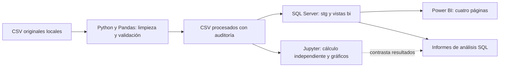
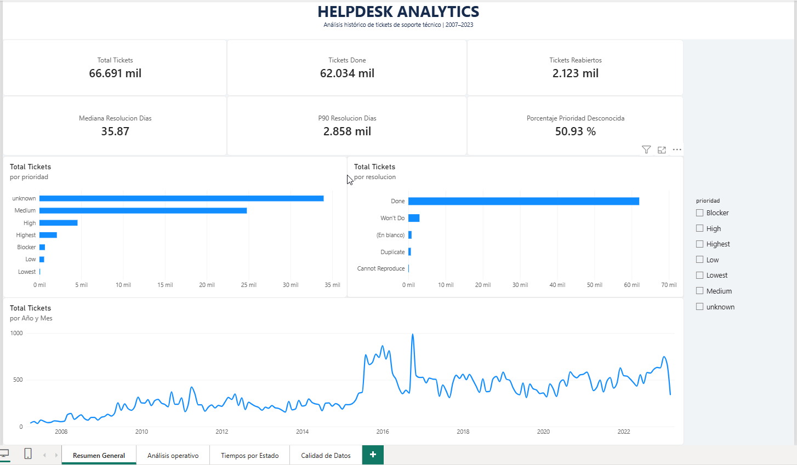
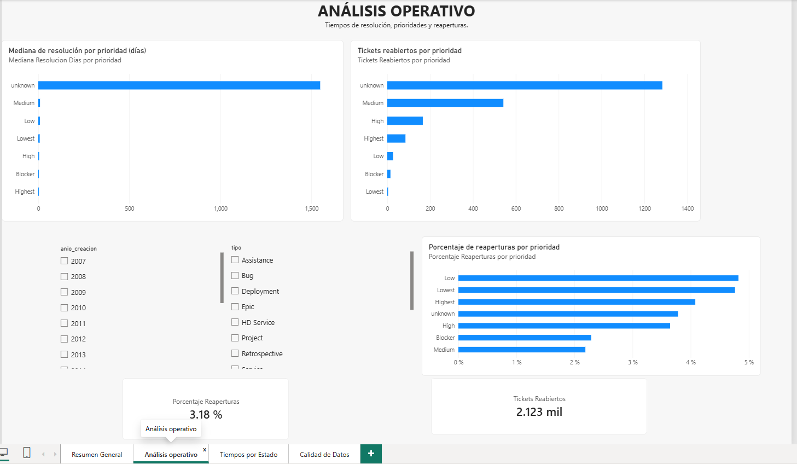
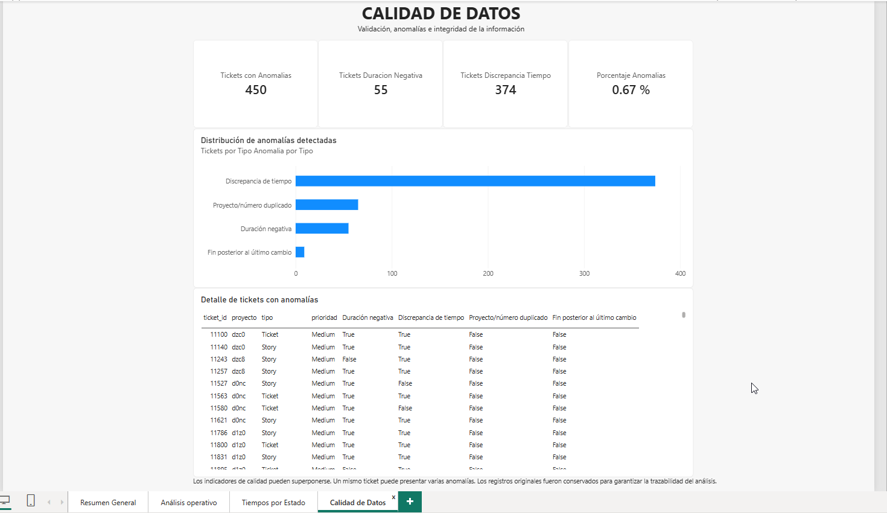

# HelpDesk Analytics

Proyecto de portafolio que integra **Python, SQL Server, Jupyter y Power BI** para analizar registros históricos de soporte, documentar la calidad de datos y comunicar hallazgos con denominadores y limitaciones explícitos.

**66.691 tickets · 257.508 eventos · 2 notebooks ejecutados · 4 páginas de Power BI**

El proyecto describe una extracción histórica: no acredita mejoras empresariales implantadas, satisfacción del usuario ni cumplimiento de SLA. El corte observado es el **14 de marzo de 2023, 14:19:32 UTC**; no representa la operación actual de un HelpDesk.

## Recorrido del portafolio

- [Análisis con Jupyter](#análisis-con-jupyter): exploración y análisis avanzado con gráficos y controles.
- [Informe final](reports/final_analysis.md): hallazgos, interpretación, limitaciones y recomendaciones.
- [Dashboard Power BI](#dashboard-power-bi): cuatro páginas con sus capturas reales.
- [Arquitectura](#arquitectura-del-proyecto) y [reproducción](#instalación-y-reproducción).
- [Checklist de publicación](reports/publication_checklist.md): auditoría, archivos permitidos y pendientes reales.

## Hallazgos principales

| Tema | Resultado verificado | Interpretación y población |
|---|---|---|
| Prioridades | 33.965 `unknown`: **50,93 %** | Sobre 66.691 tickets. No equivale a prioridad baja |
| Tiempo calendario de `Done` | **35,87 días** de mediana y **2.858,35 días** de P90 | 62.034 elegibles; incluye esperas y períodos no laborales |
| Sensibilidad temporal de `Done` | Desde 2016: **9,08 días** de mediana y **103,06 días** de P90 | 38.747 elegibles; aparta 23.287 de la base. Son poblaciones distintas, sin inferencia causal |
| Reaperturas | **2.123 tickets**, 2.364 visitas agregadas y 2.325 eventos | 3,1833 % sobre 66.691 agregados conocidos; la tasa por eventos usa 66.650 tickets con historial |
| Calidad | **450 tickets señalados**, 55 con negativos y 374 con discrepancia de duración | 44 combinan negativos y discrepancia; los flags se solapan |
| Duración por estado | `pending_deployment`: mediana no negativa de **12,00 días**, n=1.413 | `open` tiene la mayor suma positiva acumulada. Los rankings no prueban cuellos de botella |

Hay **39 tickets** con conteos de reapertura distintos entre fuentes: 38 con más visitas agregadas y uno con más eventos. La diferencia neta es 39 y la suma absoluta, 41. No son el mismo indicador.

Fuentes de cifras y definiciones: [exploración SQL](reports/sql_exploration.md), [análisis avanzado SQL](reports/sql_advanced_analysis.md), [calidad](reports/data_quality.md) y [conclusiones](reports/final_analysis.md). `Done` es una resolución registrada, no satisfacción; tiempo calendario y duración acumulada no son horas trabajadas.

## Arquitectura del proyecto

El flujo principal es **CSV → Python → SQL Server → Power BI**. Python produce CSV procesados con trazabilidad; la carga SQL preserva los datos y los flags; las vistas `bi` separan granularidades para Power BI.



**Jupyter complementa el flujo:** lee los CSV procesados, explica operaciones y contrasta resultados con los informes SQL. Los notebooks no conectan al servidor, no duplican el ETL ni modifican Power BI.

| Capa | Granularidad y evidencia |
|---|---|
| Tickets | Una fila por ticket; 66.691 filas |
| Historial | Una fila por evento; 257.508 filas |
| Estados | Una pareja ticket–estado; 1.333.820 filas para 20 estados |
| SQL | [Consultas](sql/) y [modelo analítico](reports/bi_data_model.md), con claves y denominadores |
| Presentación | Notebooks, informe final y páginas de Power BI |

Las relaciones de Power BI parten de tickets hacia eventos y estados, con filtro único. Aplanar las tablas hijas multiplicaría registros. Los detalles de precisión, fechas UTC y filtros están en [la guía del modelo](powerbi/model_setup.md).

## Análisis con Jupyter

| Notebook | Contenido | Entrega ejecutada |
|---|---|---|
| [01 · Análisis exploratorio](notebooks/01_exploratory_analysis.ipynb) | Dimensiones, ausencias, anomalías, prioridades, resoluciones y evolución temporal | 43 celdas; 4 figuras; 24 controles |
| [02 · Análisis avanzado](notebooks/02_advanced_analysis.ipynb) | Mediana/P90, cohortes, prioridad y tipo, reaperturas, estados y sensibilidad | 42 celdas; 7 figuras; 47 controles |

Las salidas guardadas son compactas y revisables en GitHub. Los datos no se incluyen; para ejecutar localmente deben estar disponibles los CSV procesados y las referencias documentales. No hace falta ejecutar el primero para utilizar el segundo.

La [guía de notebooks](notebooks/README.md) contiene los comandos completos, selección de `.venv` en VS Code, ejecución sin interfaz, variables UTF-8 y configuración local de Jupyter. Las tablas SQL y los cálculos independientes de Pandas/NumPy permiten comprobar los indicadores sin credenciales.

## Dashboard Power BI

El archivo local `powerbi/HelpDesk_Analytics.pbix` contiene cuatro páginas. Se comprobó su estructura; esta fase no valida cada medida DAX ni el comportamiento de los filtros en Desktop. El PBIX está excluido de Git porque puede contener datos importados y configuración de conexiones.

Las cuatro capturas reales se conservan sin modificaciones en `powerbi/screenshots/`. Se verificaron su formato PNG, la información visible y las rutas relativas; no están excluidas por `.gitignore`. Las imágenes muestran el estado visual del dashboard, con sus formatos abreviados y redondeos. Para consultar cifras exactas, poblaciones y denominadores, utilizar el [informe final](reports/final_analysis.md).

### Resumen General

Presenta el volumen de tickets, las resoluciones `Done`, las reaperturas, los indicadores calendario y la prioridad desconocida. Incluye distribuciones por prioridad y resolución, evolución temporal y filtro de prioridad.



### Análisis Operativo

Compara la mediana de resolución y las reaperturas por prioridad, diferenciando cantidades y porcentajes. Los filtros de año de creación y tipo permiten explorar segmentos; las diferencias observadas no prueban causalidad.



### Tiempos por Estado

Muestra la mediana del tiempo acumulado por estado y la cantidad de tickets que lo recorrieron. Ambas magnitudes responden a preguntas distintas: una duración acumulada no equivale a horas trabajadas.


### Calidad de Datos

Resume los tickets señalados, duraciones negativas y discrepancias de tiempo, e incluye una distribución de anomalías y una tabla de detalle. Los indicadores pueden solaparse; sus conteos no deben sumarse como tickets únicos.



La revisión visual no detectó nombres personales, correos, credenciales ni detalles de conexión. La tabla de Calidad de Datos conserva IDs de registros y códigos de proyecto enmascarados del dataset público; no son identidades de usuarios ni claves de acceso. Las capturas no sustituyen la auditoría de las medidas y filtros del modelo.

## Instalación y reproducción

### 1. Crear el entorno

Se requiere **Python 3.11 o superior**. El entorno comprobado utiliza Python 3.13.2. Desde la raíz, en PowerShell, crear `.venv` si aún no existe:

```powershell
python --version
python -m venv .venv
.\.venv\Scripts\python.exe -m pip install -r requirements.txt
.\.venv\Scripts\python.exe -m ipykernel install --sys-prefix --name helpdesk-analytics --display-name "Python (.venv HelpDesk Analytics)"
```

En Linux/macOS, utilizar `python3 -m venv .venv` y `.venv/bin/python` en lugar del ejecutable de Windows. No se depende de activar el entorno ni de modificar la política de ejecución de PowerShell.

`requirements.txt` incluye las dependencias utilizadas: Pandas, NumPy, Matplotlib, pyodbc, python-dotenv, ipykernel, nbformat y nbclient. `IPython.display` está disponible mediante ipykernel. `requirements-dev.txt` añade SQLFluff para pruebas de sintaxis T-SQL. Los rangos de versiones no son un archivo de bloqueo exacto; los notebooks muestran las versiones de ejecución.

### 2. Obtener y preparar los datos

Descargar manualmente de la fuente atribuida los archivos `issues.csv` e `issues_change_history.csv` y colocarlos en `data/raw/`. Los CSV no se descargan ni se incluyen automáticamente en el repositorio. El diccionario público `data/FEATURES.md` sí se incluye.

Para una reproducción nueva del procesamiento:

```powershell
.\.venv\Scripts\python.exe src/inspect_data.py data/raw/issues.csv
.\.venv\Scripts\python.exe src/clean_data.py
```

La limpieza genera los CSV en `data/processed/` y el informe de calidad. Preserva filas, nulos, `unknown`, negativos y trazabilidad; no imputa datos para mejorar indicadores. Si ya se dispone de los archivos procesados validados, pasar directamente a los notebooks. En esta revisión de publicación no se regeneraron los datos.

### 3. Ejecutar los notebooks sin SQL Server

Abrir la carpeta en VS Code con las extensiones Python y Jupyter, seleccionar **Python (.venv HelpDesk Analytics)**, reiniciar el kernel y utilizar **Ejecutar todo / Run All**. Los comandos de terminal y la configuración UTF-8 se encuentran en [notebooks/README.md](notebooks/README.md#ejecutar-sin-interfaz).

### 4. Reproducir la capa SQL en un entorno nuevo

SQL Server y su controlador ODBC se instalan por separado; `pip` no instala el motor ni el driver. Configurar credenciales sólo en `.env` local o en el entorno. La plantilla contiene valores de ejemplo y campos de autenticación vacíos:

```powershell
if (-not (Test-Path -LiteralPath .env)) { Copy-Item .env.example .env }
# Completar .env localmente; no guardar contraseñas en notebooks ni consultas.
.\.venv\Scripts\python.exe src/sql_connection.py
```

Para una base nueva con destino vacío, el cargador puede crear el esquema y validar la importación:

```powershell
.\.venv\Scripts\python.exe -m src.load_to_sql --create-schema
.\.venv\Scripts\python.exe -m src.bi_views --apply
```

Estos dos comandos crean objetos o cargan datos y **no forman parte de la revisión de publicación**. El cargador rechaza tablas pobladas e incompatibles; no usarlo como recarga del entorno ya implementado. La configuración TLS del ejemplo corresponde a desarrollo local y debe ajustarse al servidor de destino.

Las consultas de `sql/03_exploratory_analysis.sql` y `sql/04_advanced_analysis.sql` son de lectura. Sus ejecutores `src.explore_sql` y `src.advanced_sql` regeneran artefactos SQL/Markdown locales al contrastar con CSV. Los resultados de las ejecuciones previas se conservan en `reports/`.

## Pruebas y estado de verificación

Instalar las dependencias de desarrollo y ejecutar:

```powershell
.\.venv\Scripts\python.exe -m pip install -r requirements-dev.txt
.\.venv\Scripts\python.exe -m unittest discover -s tests -v
.\.venv\Scripts\python.exe -m pip check
```

**Revisión del 15 de noviembre de 2026:** 35 pruebas descubiertas; **31 superadas y 4 de integración omitidas por defecto**. Los notebooks se verifican aparte con sus 24 y 47 controles. Los tests usan casos sintéticos y datos locales para revisar limpieza, claves, conversiones exactas, carga parametrizada, transacciones simuladas, DDL y vistas.

La integración real de sólo lectura se repitió el 15 de noviembre de 2026 fuera del entorno restringido: **4 pruebas ejecutadas y superadas; 0 fallidas, errores u omitidas**. Las tres vistas `bi` resultaron accesibles, con sus definiciones intactas y los conteos esperados. El intento anterior con `SQLSTATE 08001` y el alcance de la reverificación se conservan en [el checklist](reports/publication_checklist.md#reverificación-sql-server--15-de-noviembre-de-2026).

Para repetirla, con SQL configurado:

```powershell
$env:HELPDESK_BI_INTEGRATION = '1'
.\.venv\Scripts\python.exe -m unittest discover -s tests -p test_bi_views_integration.py -v
Remove-Item Env:HELPDESK_BI_INTEGRATION
```

Estas cuatro pruebas consultan las vistas existentes y no ejecutan DDL ni carga. En un clon sin CSV, algunos tests de contrato requieren obtener primero los datos locales. El registro de alcance, limitaciones y pendientes está en [el checklist](reports/publication_checklist.md).

## Estructura del proyecto

```text
data/                    # CSV locales excluidos; FEATURES.md y marcadores públicos
src/                     # Limpieza, carga, conexión y validación analítica
sql/                     # DDL, exploración, análisis avanzado y vistas bi
notebooks/               # Dos notebooks ejecutados y su guía
powerbi/                 # Guía del modelo y capturas reales en screenshots/; PBIX local excluido
reports/                 # Evidencia histórica, informe final y checklist
reports/figures/         # Recursos gráficos complementarios
tests/                   # Pruebas locales y cuatro pruebas SQL opcionales
requirements.txt         # Dependencias de uso y notebooks
requirements-dev.txt     # Dependencias de desarrollo
.env.example             # Plantilla pública sin secretos
```

## Fuente de datos y atribución

- **Dataset y autor:** Mohammad Abdellatif, *Help Desk Tickets*, versión 3.
- **Fuente:** [Mendeley Data](https://data.mendeley.com/datasets/btm76zndnt/3).
- **DOI:** [10.17632/btm76zndnt.3](https://doi.org/10.17632/btm76zndnt.3).
- **Licencia del dataset:** [Creative Commons Attribution 4.0 International, CC BY 4.0](https://creativecommons.org/licenses/by/4.0/).

La ficha del proveedor y su licencia se consultaron el 15 de noviembre de 2026. La atribución requiere crédito, enlace a la licencia e indicación de cambios. Los CSV originales permanecen intactos; la limpieza, los campos de auditoría y los análisis derivados se documentan en [calidad de datos](reports/data_quality.md). `data/FEATURES.md` es documentación del proveedor, no código propio: conserva su texto salvo un ajuste editorial indicado que añade atribución y dirige el enlace al diagrama ausente a la fuente original.

La ficha web actual describe datos desde 2007; el `FEATURES.md` local describe tickets desde 2016. Las creaciones observadas comienzan en abril de 2007 y los eventos en agosto de 2015. Se mantienen esas diferencias de documentación y cobertura, sin corregir fechas ni inferir una causa.

El **código propio** se distribuye bajo la [licencia MIT](LICENSE): comprende el código Python, las consultas SQL y las celdas de código propias de los notebooks. Copyright (c) 2026 Daniel Prado Jimenez, titular confirmado expresamente para este proyecto.

El **dataset original mantiene su licencia CC BY 4.0**. Esa atribución también acompaña al material del proveedor, como `data/FEATURES.md`, y a los extractos del dataset reproducidos en informes, salidas y capturas. La MIT del código no cambia la licencia de esos datos ni implica respaldo del proveedor al proyecto. Se mantienen el crédito, la fuente y la indicación de las transformaciones realizadas.

## Preparación para GitHub

Los candidatos de publicación son código, consultas, documentación, notebooks con salidas revisadas, dependencias, `.env.example` y el diccionario público del proveedor. Los CSV, `.env`, `.venv`, PBIX, bases de memoria local, archivos de credenciales y cachés se excluyen. La revisión de seguridad de la fase 6.5 confirmó la procedencia pública de las claves de registros y de los códigos de proyecto ya enmascarados que aparecen en los cuatro informes históricos. No se publican valores de usuarios ni credenciales en esos informes. Las claves siguen siendo enlazables con el dataset público; no se presentan como anonimización irreversible. El detalle y los límites de la revisión están en [el checklist](reports/publication_checklist.md#revisión-final-de-seguridad-y-licencia--fase-65).

La fase 6.6 **inicializó el repositorio Git local en la rama `main`** y preparó 52 archivos revisados para el primer commit. No se creó ningún commit, no se configuraron remotos y no se publicó ni ejecutó push. La revisión cubre el contenido real del staging; si se pretende incorporar otro historial, debe conservarse y revisarse antes de vincularlo.

Las cuatro capturas están integradas y verificadas, los notebooks están validados y las cuatro pruebas SQL pasaron. La fase 6.5 completó la revisión de granularidad de los informes históricos y añadió `LICENSE` MIT 2026, sin alterar resultados. La fase 6.6 revisó las exclusiones y los archivos preparados: el primer commit queda pendiente de aprobación. Publicar o hacer push requiere autorización posterior. Véase [el checklist final de publicación](reports/publication_checklist.md).

## Historial técnico conservado

<details>
<summary>Documentación original de las fases 3 y 4</summary>

Los apartados siguientes se conservan como registro de sus entregas originales. Las referencias a etapas pendientes describen aquel momento; el estado actual está documentado arriba. Los informes originales de `reports/` también permanecen intactos.


## Fase 3.1: preparación de SQL Server

Archivos principales:

- `sql/01_create_database.sql`: crea HelpDeskAnalytics sólo si no existe, desde master y fuera de una transacción explícita.
- `sql/02_create_tables.sql`: crea el esquema stg y las tablas faltantes; no modifica tablas preexistentes ni carga registros.
- `reports/sql_schema.md`: diccionario exhaustivo de las 102 columnas de issues y 28 de histórico, tipos, nulabilidad, longitudes, escalas y hashes de los CSV inspeccionados.
- `reports/sql_environment.md`: comprobaciones reales del entorno y diagnóstico pendiente.
- `src/sql_connection.py`: configuración por variables de entorno y prueba con SELECT exclusivamente.
- `src/prepare_sql_schema.py`: genera el DDL y el diccionario tras validar todos los valores de los CSV; no requiere SQL Server ni modifica CSV.
- `tests/test_sql_schema.py`: pruebas del contrato, precisión, cobertura de columnas, claves y configuración.

El modelo es `stg.issues(id)` **1:N** `stg.issue_change_history(issueid)`. Cada tabla tiene PK clustered en id y la segunda una FK sin cascadas. Las fuentes actuales tienen claves no nulas y únicas, sin huérfanos. No se declara UNIQUE para proyecto/número (65 filas con colisiones), ni para change_group_id. El único índice adicional es `(issueid, created)` para joins y secuencia temporal; otros índices dependerán de las consultas y sus planes.

Se usa BIGINT para IDs, contadores integrales y dq_source_row; DATETIMEOFFSET(7) para fechas con UTC; DECIMAL(38,16) para wf_* (hasta 16 decimales observados, sin redondeo ni FLOAT); NVARCHAR(256) para texto y __raw, con longitud UTF-16 comprobada; BIT para los demás dq_*. No se imponen restricciones de duración positiva ni de orden temporal que impidan conservar las anomalías. Los nulos opcionales y unknown permanecen, sin defaults ni imputación. Detalle y justificación en el diccionario.

### Conexión Python

Instalar SQL Server y ODBC Driver 18 en el equipo de ejecución cuando no estén disponibles. La conexión actual funciona con autenticación SQL y `SQL_TRUST_SERVER_CERTIFICATE=yes` para desarrollo local. HelpDeskAnalytics ya existe y tiene los datasets cargados. `reports/sql_environment.md` conserva el diagnóstico histórico; `reports/sql_load_report.md` registra la ejecución exitosa.

Desde PowerShell en la raíz del proyecto:

```powershell
.\.venv\Scripts\python.exe -m pip install -r requirements.txt
Copy-Item .env.example .env  # sólo si .env todavía no existe
# Editar .env localmente: instancia, base master, autenticación y TLS.
.\.venv\Scripts\python.exe src/sql_connection.py
```

El diagnóstico devuelve 0 sólo si conecta y completa SELECT; devuelve 1 si falla o falta configuración. No muestra la cadena de conexión ni contraseñas. `.env` está excluido de Git y `.env.example` contiene sólo ejemplos. Las variables del proceso prevalecen sobre `.env`.

Variables: SQL_SERVER (obligatoria), SQL_DATABASE (master para diagnóstico inicial; luego HelpDeskAnalytics), SQL_DRIVER, SQL_AUTH (windows o sql), SQL_ENCRYPT y SQL_TRUST_SERVER_CERTIFICATE. Con windows se usa la identidad de la sesión. Con sql se requieren SQL_USER y SQL_PASSWORD locales. En este desarrollo local se usa Encrypt=yes y TrustServerCertificate=yes; en otros entornos configurar un certificado confiable y usar TrustServerCertificate=no. El cargador elige master para creación y HelpDeskAnalytics para carga sin editar .env.

### Ejecución manual del DDL cuando la conexión funcione

En SSMS, abrir y ejecutar primero `sql/01_create_database.sql` y después `sql/02_create_tables.sql`. Se requieren permisos para crear bases, esquemas, tablas e índices. Alternativa con sqlcmd instalado y autenticación Windows:

```powershell
sqlcmd -S localhost -E -N -b -i sql/01_create_database.sql
sqlcmd -S localhost -E -N -b -i sql/02_create_tables.sql
```

Reemplazar localhost por la instancia configurada. Estos comandos son una alternativa con autenticación Windows; para la configuración SQL actual utilizar el cargador Python de la sección siguiente. GO es un separador de lotes de SSMS/sqlcmd, no una instrucción que se pueda enviar directamente con pyodbc. Ambos scripts ya se ejecutaron en Fase 3.3 mediante el cargador. El DDL no es una migración de estructuras existentes; el cargador compara el catálogo antes de reutilizarlas y rechaza conflictos.

### Validación sin conexión

```powershell
.\.venv\Scripts\python.exe -m src.prepare_sql_schema
.\.venv\Scripts\python.exe -m unittest discover -s tests -v
.\.venv\Scripts\python.exe -m pip install -r requirements-dev.txt
.\.venv\Scripts\python.exe -m sqlfluff parse --ignore-local-config --dialect tsql sql/01_create_database.sql
.\.venv\Scripts\python.exe -m sqlfluff parse --ignore-local-config --dialect tsql sql/02_create_tables.sql
```

La generación vuelve a escribir únicamente el DDL 02 y el diccionario tras comprobar precisión, tipos, claves, longitudes y hashes de los CSV. El parser T-SQL comprueba sintaxis estática, no permisos ni compilación contra el motor. Los CSV grandes siguen excluidos por `.gitignore`.

## Fase 3.3: carga inicial y validación

La carga actual se confirmó: **66.691 tickets**, **257.508 eventos**, **0 IDs duplicados**, **0 huérfanos** y **14.012.706 celdas comparadas exactamente**. Permanecen los 55 tickets con tiempos negativos, 374 discrepancias de duración y demás advertencias de Fase 2. La carga preserva las anomalías documentadas.

Para un entorno nuevo, con los CSV procesados y .env local configurado:

```powershell
.\.venv\Scripts\python.exe -m src.load_to_sql --create-schema
```

Si las tablas ya existen y están vacías, omitir `--create-schema`. También admite `python src/load_to_sql.py`. El tamaño predeterminado es 1.000 filas por lote; `--batch-size` acepta de 1 a 10.000. Se usa `fast_executemany` y `setinputsizes` explícito. `--no-fast` permite evaluar el modo convencional con las mismas comprobaciones; no se activa automáticamente ni ignora errores.

El comando **rechaza tablas con datos** y estructuras incompatibles. La carga actual ya está realizada: un nuevo intento termina sin insertar. No es una herramienta de recarga, reemplazo ni actualización.

El proceso:

1. Lee y valida los CSV como texto, con tipos definidos en el DDL; verifica conteos, columnas, rangos, precisión y relaciones.
2. Comprueba master y el catálogo. Con `--create-schema`, ejecuta sólo los scripts necesarios para objetos ausentes, separando GO fuera de literales/comentarios. Nunca altera objetos para resolver incompatibilidades.
3. Verifica tipos/nulabilidad, PK clustered, FK habilitada y confiable sin cascadas e índice `(issueid, created)`. Rechaza triggers habilitados, columnas identity/calculadas/defaults, CHECK adicionales o índices fuera del contrato.
4. Prueba una selección de registros reales (NULL, negativos, precisión decimal, fechas fraccionarias e indicadores) con el modo ODBC elegido; compara cada celda y hace ROLLBACK. Los eventos de prueba incluyen sus tickets padres.
5. Abre una transacción explícita con `XACT_ABORT ON`, bloquea las tablas con `TABLOCKX,HOLDLOCK` y comprueba nuevamente que estén vacías. Inserta primero tickets y luego eventos con parámetros.
6. Antes de COMMIT compara **todas las celdas**, no sólo muestras, ordenadas por ID. Comprueba conteos, unicidad, huérfanos, NULL por columna, negativos por duración, todos los flags y concordancia con `reports/data_quality.md`. Verifica también que los hashes de los CSV sigan intactos.
7. Confirma una sola vez; consulta desde otra conexión los conteos persistidos y escribe `reports/sql_load_report.md`. Un fallo previo a COMMIT revierte la carga completa. Si se pierde la confirmación del COMMIT, informa estado incierto y exige inspección antes de reintentar. Un intento fallido posterior conserva el reporte exitoso y genera un reporte de intento con fecha.

Conversiones: vacíos/Pandas NA→None→NULL; enteros sin paso por float; True/False→BIT; textos/unknown/__raw intactos. Decimal se valida con precisión de 50 dígitos y se envía como texto Unicode exacto de escala 16 a `CONVERT(DECIMAL(38,16), ?)`. DATETIMEOFFSET usa ISO8601 UTC con siete decimales y conversión SQL explícita para conservar offset y precisión de 100 ns. El formato textual numérico puede cambiar (p. ej. `.0`→`.0000000000000000`); el valor permanece exacto y el CSV original permanece intacto.

La ejecución real utilizó ODBC **18.07.0001** y pyodbc **5.5.0**. La prueba reversible de 88 tickets/5 eventos pasó. Inserción: **30,587 s**; validación completa: **37,618 s**; carga con validación y COMMIT: **68,206 s**; proceso completo: **82,125 s**. No se detectó pérdida de precisión, zona horaria o texto con esta configuración.

Las 25 pruebas locales pasaron, incluidas 13 nuevas de importación (límites numéricos, precisión temporal, NULL, Unicode, GO, rechazo de destinos ocupados e incompatibles, lotes parametrizados y control de transacciones). Las pruebas automáticas no necesitan SQL Server ni insertan datos ficticios en él:

```powershell
.\.venv\Scripts\python.exe -m unittest discover -s tests -v
```

Una carga fallida puede dejar la base y las tablas recién creadas vacías: la creación de base se ejecuta fuera de la transacción de datos. No se eliminan esos objetos. Futuras entradas con claves inválidas requieren un diseño de cuarentena que conserve registros, no ajustes para forzar restricciones. Power BI sigue pendiente.

## Fase 3.4: exploración con SQL

`sql/03_exploratory_analysis.sql` contiene 14 consultas de lectura: catálogo (S), totales (A), prioridad/tipo/estado/resolución (B–E), creación anual y mensual (F–G), top 10 proyectos (H), cobertura de historial (I), flags (J), cruce estado/resolución (K), cobertura temporal (L) y procedencia (M). En SSMS elegir HelpDeskAnalytics antes de ejecutarlo.

Para ejecutar las mismas consultas, comparar los resultados con los CSV mediante Pandas y regenerar `reports/sql_exploration.md`:

```powershell
.\.venv\Scripts\python.exe -m src.explore_sql
```

El reporte conserva todas las distribuciones y los 192 meses observados, explica cada consulta y propone indicadores. Pasaron 26 comprobaciones de conteos, porcentajes, prioridades, tipos, estados, resoluciones, top 10, historial, flags, fechas y procedencia. El parser T-SQL aceptó el archivo. No se modifican datos ni se crean objetos.

Hallazgos: unknown representa 50,9289%; existen 15 tipos distintos; 220 tickets closed/done tienen resolución NULL; 23.717 tickets son anteriores a 2016. Los estados finales no demuestran éxito, y la cobertura temporal real comienza en 2007 pese al intervalo distinto descrito en FEATURES.md. Los porcentajes usan denominadores explícitos y las categorías originales permanecen separadas.

## Fase 3.5: tiempos, reaperturas y estados

Consultas de lectura en `sql/04_advanced_analysis.sql`; definiciones, poblaciones, exclusiones, resultados completos y recomendaciones de visualización en `reports/sql_advanced_analysis.md`. Reproducción y validación independiente:

```powershell
.\.venv\Scripts\python.exe -m src.advanced_sql
```

El ejecutor genera el SQL, calcula resultados desde los CSV con Pandas, ejecuta 14 SELECT/CTE y contrasta 13 conjuntos de resultados (370 filas de comparación), además de auditar UTC y precisión temporal. No modifica registros ni estructuras. Los hashes de raw y processed permanecen intactos. El parser T-SQL aceptó las 14 consultas.

Se usan `DATEDIFF_BIG(MICROSECOND)` para tiempo calendario creación→resolución y `PERCENTILE_CONT` para mediana/P90, con interpolación lineal verificada. No se usa wf_total_time como sustituto del intervalo. Done y otras resoluciones se separan; los flags de workflow sólo filtran escenarios de sensibilidad. El histórico se preagrupa antes de unirlo para conservar una fila por ticket.

Resultados base Done: 62.034 elegibles, mediana **35,8675 días**, P90 **2.858,3523 días**. Otras resoluciones: 3.804 elegibles; 853 tickets sin resolución quedan fuera de los percentiles. La sensibilidad de creaciones desde 2016 conserva 38.747 Done, con mediana **9,0814 días** y P90 **103,0591 días**. No equivale a corregir ni eliminar los tickets anteriores.

Reaperturas: 2.123 tickets con visitas agregadas, 2.364 visitas frente a 2.325 eventos observados y 39 tickets discrepantes. Responsables: 62.706 eventos assignee; mediana global 1 entre tickets con historial; 16.791 tienen múltiples eventos. Los eventos no equivalen automáticamente a reasignaciones efectivas. Se publican por separado duración acumulada por estado, negativos y promedio por visita.

Las cohortes incluyen población total, elegibles Done, fechas de resolución ausentes, parcialidad calendario y seguimiento hasta el corte observado. Un período calendario completo puede tener seguimiento incompleto. Los tiempos son calendario, no laborales; no se calculan SLA ni se concluye ineficiencia a partir de duraciones extensas. Power BI continúa pendiente.

## Fase 3.6: vistas para Power BI

DDL en `sql/05_bi_views.sql`; modelo, diccionario real, denominadores, tipos, relaciones y conexión Desktop en `reports/bi_data_model.md`. El diseño fuente está en `reports/bi_data_model_design.md`.

| Vista | Filas verificadas | Granularidad |
|---|---:|---|
| bi.vw_tickets | 66.691 | Ticket, clave ticket_id |
| bi.vw_ticket_events | 257.508 | Evento, clave event_id; ticket_id asociado |
| bi.vw_ticket_state_durations | 1.333.820 | Ticket × estado, clave (ticket_id, estado); 20 estados |

`vw_tickets` preagrupa eventos por issueid, conserva dimensiones y todos los dq_*, y ofrece tiempos calendario/eligibilidad sin percentiles estáticos. Las fechas se normalizan a UTC y se exponen como DATETIME2(7). `vw_ticket_events` conserva los valores NULL y la auditoría. La vista larga conserva duraciones DECIMAL exactas, negativos, visitas y pares no recorridos con NULL; wf_total_time no es un estado. El texto duracion_segundos_exacta permite auditar precisión que el modelo numérico de Power BI no conserva íntegramente.

Las tres vistas ya existen. El ejecutor sólo crea faltantes, reutiliza definiciones idénticas y rechaza conflictos sin sustituir objetos. Despliegue y validaciones están en una transacción; stg se verifica mediante SHA-256 de todas sus filas/columnas antes y después. Usar sólo generación o aplicar/validar explícitamente:

```powershell
.\.venv\Scripts\python.exe -m src.bi_views
.\.venv\Scripts\python.exe -m src.bi_views --apply
```

Se superaron 20 validaciones SQL, 31 pruebas locales/regresión (6 nuevas de vistas) y 4 pruebas de integración reales de sólo lectura con Pandas. Para repetir pruebas locales:

```powershell
.\.venv\Scripts\python.exe -m unittest discover -s tests -v
```

Las cuatro pruebas SQL se omiten salvo activación explícita:

```powershell
$env:HELPDESK_BI_INTEGRATION='1'
.\.venv\Scripts\python.exe -m unittest discover -s tests -p test_bi_views_integration.py -v
Remove-Item Env:HELPDESK_BI_INTEGRATION
```

Para la conexión posterior: Obtener datos → SQL Server → HelpDeskAnalytics → Importar; autenticar mediante Base de datos en el diálogo seguro y elegir exclusivamente las tres vistas bi. Las credenciales de .env no se transfieren a Desktop. Relaciones: tickets[ticket_id] 1→* eventos[ticket_id] y tickets[ticket_id] 1→* estados[ticket_id], filtro único desde tickets. No relacionar eventos con estados ni habilitar bidireccionalidad; los filtros propios de una hija no se propagan hacia la otra. Medianas/P90 se calcularán dinámicamente con elegibilidad y denominadores explícitos. Todavía no se crea el dashboard.

## Fase 4.1: preparación manual del modelo Power BI

Guía: [powerbi/model_setup.md](powerbi/model_setup.md). Incluye conexión mediante Importar, tipos de cada columna, relaciones 1:* con filtro único desde tickets, validaciones sin DAX, campos de auditoría que podrían ocultarse y advertencias de UTC, precisión y doble conteo.

**Ruta de trabajo prevista del PBIX:** `powerbi/HelpDesk_Analytics.pbix`. Ya existe un archivo local con ese nombre; no fue abierto, modificado ni validado internamente en esta fase. Su presencia no demuestra que el modelo esté configurado. `*.pbix` permanece excluido de Git mediante `.gitignore`.

Los conteos de referencia SQL son 66.691 tickets, 257.508 eventos y 1.333.820 filas ticket–estado. Las comprobaciones de la guía quedan pendientes de realizar y registrar manualmente en Desktop. Esta entrega es documental: no modifica SQL, no controla la interfaz y no crea medidas DAX ni visualizaciones.

</details>
