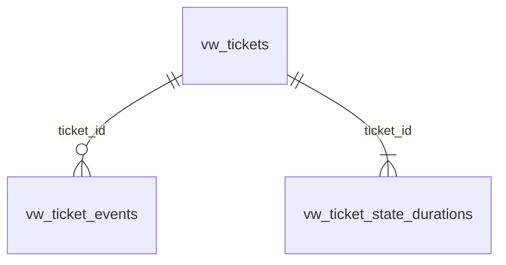

# Capa analítica para Power BI — Fase 3.6

Este documento es el diseño versionado; `bi_data_model.md` lo incorpora y añade resultados y diccionario reales tras el despliegue. DDL: [05_bi_views.sql](../sql/05_bi_views.sql). Ejecutor: `python -m src.bi_views --apply`; sin `--apply` sólo genera el SQL. Rechaza objetos existentes cuya definición difiera, sin ALTER, borrados ni sustituciones. Reutiliza vistas idénticas; crea sólo faltantes. El DDL está en una transacción y las verificaciones se completan antes del COMMIT. Las tablas stg y los CSV se conservan.

## Objetivo, granularidad y claves

| Vista | Grano | Clave lógica | Uso |
|---|---|---|---|
| bi.vw_tickets | Una fila por ticket | ticket_id | Filtros de creación, proyecto, tipo, prioridad, estado final, resolución y calidad; tiempos calendario y conteos observados de eventos |
| bi.vw_ticket_events | Una fila por registro histórico | event_id | Eventos status/assignee, valor nuevo y fecha UTC; FK lógica ticket_id |
| bi.vw_ticket_state_durations | Una fila por pareja ticket–estado | (ticket_id, estado) | Duración acumulada y número de visitas por estado, incluidos NULL, ceros y negativos; FK lógica ticket_id |

Claves lógicas verificadas mediante SELECT: las vistas no introducen PK/FK físicas nuevas. Con 20 estados y 66.691 tickets hay **1.333.820 filas** en la estructura larga. No son 1.333.820 tickets ni visitas. Los 257.508 eventos se conservan íntegramente; no se filtra calidad, tipo o antigüedad.

## Vista de tickets: definiciones

- `ticket_id`, `proyecto`, `tipo`, `prioridad`, `estado`, `resolucion`: atributos originales, sin COALESCE, recortes ni unificación de categorías. unknown permanece explícito y no significa prioridad baja. Estado final y resolución son conceptos distintos.
- `creacion_utc`, `resolucion_utc`: `SWITCHOFFSET(origen,'+00:00')` seguido de `CAST(... AS DATETIME2(7))`. Se normaliza el instante a UTC antes de retirar el offset; no se convierte a hora local. Los NULL permanecen. `fecha_creacion_utc` es DATE, y `anio_creacion`, `mes_creacion`, `periodo_creacion` soportan filtros cronológicos.
- `intervalo_calendario_segundos`: diferencia entre ambas fechas, con signo y hasta 7 decimales. Se obtiene con `DATEDIFF_BIG(SECOND)` más la diferencia de fracciones de segundo; así se corrigen las fronteras de segundo y se conserva precisión de 100 ns sin el riesgo de desbordamiento de un DATEDIFF en nanosegundos. Un intervalo negativo se conserva aquí para auditoría.
- `elegible_calendario`: resolución no NULL, fechas presentes y resolución≥creación. `elegible_done` añade resolución exactamente Done; `elegible_otra_resolucion` añade resolución no Done. `motivo_elegibilidad` prioriza sin_resolucion, sin_fechas, orden_negativo y elegible.
- `tiempo_calendario_segundos` y `tiempo_calendario_dias`: sólo para elegibles; NULL en los demás. Días=segundos/86.400, DECIMAL(28,12). Son calendario, incluyen pausas y fines de semana; no son horas trabajadas ni SLA. `wf_total_time_segundos` se expone aparte para auditoría y nunca sustituye este intervalo.
- `cantidad_eventos`, `eventos_reopened`, `eventos_assignee`: histórico **preagrupado por issueid antes del LEFT JOIN**. Reopened cuenta field=status y value=reopened exactos; assignee cuenta field=assignee incluso si valor es NULL. Se usa 0 exclusivamente para ausencia de eventos en esta extracción: conteo de un conjunto vacío, no imputación de datos de negocio. Tener 0 eventos observados no demuestra que nunca existieran.
- `tiene_historial`: al menos un evento en la extracción. `inicio_historial_observado_utc` es un límite de cobertura global, no una métrica comercial dinámica. No cambia por filtros del reporte. `creacion_anterior_inicio_historial` puede ser NULL si no hay fechas/límite. `cobertura_historica` distingue sin eventos, creación anterior/después del inicio o desconocida. Ningún grupo se declara historia completa.
- `visitas_reopened_agregadas`: wfe_reopened original, incluidos posibles NULL. `reaperturas_comparables` requiere agregado conocido e historial; `diferencia_reopened` sólo existe entonces. No se trata ausencia de historial como cero reaperturas históricas.
- Todos los `dq_*` de issues se conservan, incluido dq_source_row. Este último es BIGINT de procedencia y no un flag. dq_missing_optional es completitud informativa; dq_duration_comparable no implica concordancia. No hay filtro automático de dq_has_problem.

Los __raw originales completos de tickets se consultan en stg por ticket_id cuando sea necesaria auditoría forense; no se reproducen todas esas columnas en el modelo de reporte.

## Vista de eventos

`event_id`, `ticket_id`, `campo`, `valor`, `evento_utc`, `fecha_evento_utc`, `grupo_cambio_id`, todos los dq_* y __raw del histórico. `valor` conserva sus 1.840 NULL legítimos; no se inventa un responsable. created se normaliza a UTC y se expone como DATETIME2(7); __raw conserva el texto original. Cada evento es un cambio de campo registrado, no necesariamente una interacción, reasignación efectiva o actualización única; varios eventos pueden compartir grupo_cambio_id. Las primeras asignaciones y valores repetidos cuentan como eventos.

## Vista de estados: parejas y ausencias

`CROSS APPLY VALUES` enlaza explícitamente cada wf_estado con **wfe_estado del mismo sufijo**. Se valida la igualdad de conjuntos contra el catálogo real y la correspondencia exacta de todas las filas mediante EXCEPT en ambas direcciones. No se usa UNPIVOT, que podría descartar NULL; no se incluye wf_total_time como estado.

| Columna/indicador | Definición |
|---|---|
| ticket_id / estado | Clave compuesta de la fila; estado de workflow, distinto del estado final del ticket |
| duracion_segundos | DECIMAL(38,16) original, sin redondeo ni recorte a cero |
| numero_visitas | BIGINT original wfe_*, sin imputación |
| duracion_segundos_exacta | Representación NVARCHAR(50) para auditoría de precisión fuera del modelo numérico aproximado |
| indicador_duracion_negativa | duracion_segundos<0 |
| duracion_faltante | duracion_segundos IS NULL |
| duracion_cero | duracion_segundos=0, distinto de NULL |
| estado_no_recorrido | numero_visitas=0 y duración NULL; evidencia coherente en los agregados, no prueba de historia completa |
| estado_recorrido | numero_visitas>0; si visitas NULL o negativas, ni este indicador ni el anterior afirman recorrido/no recorrido |
| elegible_duracion_no_negativa | Duración conocida ≥0; denominador=positivos+ceros |
| elegible_promedio_visita | Duración≥0 y visitas>0 |
| promedio_por_visita_segundos | Duración/visitas por pareja ticket–estado, sólo si elegible; FLOAT para cálculo analítico, igual a Fase 3.5 |

Para valores discordantes (p. ej. duración no NULL y visitas=0) se conservan ambos campos; no se fuerza estado_no_recorrido. NULL no significa cero. Un promedio por visita de un ticket no equivale a la media ponderada de todas las visitas. Una duración extensa no demuestra ineficiencia.

## Relaciones propuestas



En Power BI: `vw_tickets[ticket_id]` **1→*** `vw_ticket_events[ticket_id]` y **1→*** `vw_ticket_state_durations[ticket_id]`, filtro **único desde tickets**. Tickets actúa como entidad de filtro compartida y contiene medidas a grano ticket; las dos tablas hijas contienen eventos y estados. No unir directamente las dos hijas, no activar filtro bidireccional ni relaciones muchos-a-muchos. No aplanarlas en una misma tabla: multiplicaría eventos por 20 estados.

Filtros de proyecto, tipo, prioridad, estado final, resolución, creación y calidad del ticket se toman de vw_tickets y llegan a ambas hijas. Filtros propios del evento o estado de workflow no regresan automáticamente al ticket ni a la otra hija. Para contar tickets bajo esos filtros usar DISTINCTCOUNT del ticket_id de la tabla hija, con el filtro apropiado; no cambiar la dirección de relación para resolverlo.

Futuro calendario: relación activa única calendario→tickets por fecha_creacion_utc; fechas de resolución/evento requieren dimensiones con roles distintos o relaciones inactivas y medidas explícitas. Evitar un mismo calendario activo conectado tanto a tickets como a eventos, porque crearía dos rutas hacia eventos. No se crea todavía calendario ni modelo Power BI.

## Indicadores futuros y denominadores dinámicos

No se guardan medianas, P90 ni tasas globales en las vistas. Se calcularán con medidas bajo los filtros activos, sobre datos granulares:

| Indicador | Numerador/población y denominador |
|---|---|
| Tickets | COUNTROWS(vw_tickets), una fila por ticket |
| Mediana y P90 calendario Done | Filtrar elegible_done=True; MEDIANX/PERCENTILEX.INC sobre tiempo_calendario_dias; publicar elegibles y excluidos de la población Done filtrada |
| Otras resoluciones | Mismas medidas con elegible_otra_resolucion; separado de Done, no categoría éxito |
| Eventos observados | COUNTROWS(vw_ticket_events) o SUM(tickets[cantidad_eventos]); nunca sumar ambos como volúmenes distintos |
| Cobertura de historial | Tickets con tiene_historial=True / tickets filtrados |
| Tickets con visita agregada reopened | visitas_reopened_agregadas>0 / tickets filtrados con agregado conocido; publicar NULL excluidos |
| Tickets con evento reopened | eventos_reopened>0 / tickets filtrados con tiene_historial=True; no mezclar denominadores |
| Discrepancia de reaperturas | diferencia_reopened<>0 / reaperturas_comparables=True |
| Mediana de eventos assignee | MEDIANX sobre tickets con tiene_historial=True, incluyendo ceros observados |
| Múltiples eventos assignee | eventos_assignee>1 / tickets con historial; no llamarlos reasignaciones efectivas |
| Duración acumulada por estado | SUM por filas de estados; acompañar suma firmada/positiva, NULL y negativos. No sumar calendario de tickets por filas de estados |
| Mediana/P90 acumulada no negativa | Por estado, filtrar elegible_duracion_no_negativa=True; mostrar elegibles y excluidos |
| Mediana del promedio por visita | Filtrar elegible_promedio_visita=True; cuantiles sobre promedio_por_visita_segundos, sin interpretarlo como duración real de cada visita |
| Sensibilidad y calidad | Comparar población base con filtros específicos; dq_has_problem no es exclusión predeterminada. unknown visible y antigüedad sin filtros ocultos |

Las columnas de conteos por ticket responden a filtros de tickets, pero no a un filtro de fecha/campo aplicado solamente a eventos; para estos análisis calcular desde eventos. `inicio_historial_observado_utc` es metadato de cobertura fijo para la extracción, no un percentil ni una tasa filtrable.

## Compatibilidad y precisión

BIGINT→número entero (IDs: no resumir); BIT→True/False; NVARCHAR→texto; DATE→fecha; DATETIME2→fecha/hora UTC ya normalizada. Power BI no conserva la zona en su modelo ni debe volver a aplicar un desplazamiento local. Usar columnas numéricas de duración para cálculos; no recalcular microsegundos a partir de fechas importadas cuya precisión puede reducirse.

SQL conserva DECIMAL(38,16) exacto; el número decimal del modelo Power BI es aproximado, de hasta 15 dígitos significativos. El decimal fijo tiene cuatro decimales y tampoco conserva 16 decimales: **no prometer equivalencia de precisión SQL/Power BI**. Para métricas usar número decimal y formato visual acordado; para auditoría usar duracion_segundos_exacta como texto o stg. Los flags de calidad se calculan en SQL sobre valores exactos y evitan comparar floats para detectar anomalías. No redondear ni transformar las tablas stg para adaptarlas al modelo.

## Conexión posterior en Power BI Desktop

1. Obtener datos → SQL Server. Indicar la instancia local configurada y base **HelpDeskAnalytics**, sin incluir credenciales en consultas.
2. Para la primera versión, seleccionar **Importar** y autenticar mediante **Base de datos** con credenciales locales autorizadas en el diálogo seguro. El archivo .env de Python no configura Power BI automáticamente.
3. En el navegador elegir exclusivamente las tres vistas del esquema bi; no importar simultáneamente sus equivalentes stg para evitar conteos duplicados.
4. En Transformar datos revisar tipos como se describe arriba, mantener unknown y NULL y comprobar UTC sin conversión a hora local. duracion_segundos_exacta es auditoría textual; puede omitirse de la carga del modelo si no se necesita, preservándola en la vista.
5. Crear explícitamente las dos relaciones 1:* de filtro único y revisar las relaciones automáticas. Establecer IDs y atributos de año/mes como No resumir. No crear aún visualizaciones en esta fase.
6. Validar los conteos iniciales antes de aplicar filtros. Las vistas no materializan datos: reflejan stg al consultar; en modo Importar, un cambio sólo aparece tras actualizar.

El ajuste de confianza de certificado usado por pyodbc para desarrollo local no se transfiere a Power BI. Configurar TLS/certificado de confianza en ese cliente si se solicita, sin publicar credenciales ni desactivar seguridad globalmente. Las instrucciones de interfaz se basan en la documentación del conector; Power BI Desktop no se ha ejecutado ni probado en esta fase.

## Limitaciones y referencias

Tickets desde 2007 e historial desde 2015; corte observado de la extracción 2023-03-14. Cohortes recientes pueden estar censuradas y meses parciales no son períodos completos. La fecha de resolución no identifica por sí sola primera o última resolución. Los tiempos no son laborales ni se dispone de SLA contractual. Las diferencias por año no se corrigen eliminando datos antiguos.

Referencias: [tipos Power BI](https://learn.microsoft.com/en-us/power-bi/transform-model/desktop-data-types), [conector SQL Server](https://learn.microsoft.com/en-us/power-query/connectors/sql-server), [diseño dimensional](https://learn.microsoft.com/en-us/power-bi/guidance/star-schema), [relaciones](https://learn.microsoft.com/en-us/power-bi/transform-model/desktop-relationships-understand). Definiciones y resultados de referencia: [sql_advanced_analysis.md](sql_advanced_analysis.md).


## Ejecución y validación real

UTC: 2026-11-14T06:32:02.354849+00:00. COMMIT del DDL confirmado.

- vw_tickets: Creada
- vw_ticket_events: Creada
- vw_ticket_state_durations: Creada

- SUPERADA: vw_tickets cantidad
- SUPERADA: vw_tickets clave única/no NULL
- SUPERADA: vw_ticket_events cantidad
- SUPERADA: vw_ticket_events clave única/no NULL
- SUPERADA: vw_ticket_state_durations cantidad
- SUPERADA: vw_ticket_events integridad referencial
- SUPERADA: vw_ticket_state_durations integridad referencial
- SUPERADA: Clave ticket/estado única
- SUPERADA: Parejas y valores exactos estados
- SUPERADA: Parejas y valores exactos estados
- SUPERADA: Eventos, NULL y auditoría exactos
- SUPERADA: Eventos, NULL y auditoría exactos
- SUPERADA: Atributos y fechas UTC de tickets intactos
- SUPERADA: Todos los dq de tickets intactos
- SUPERADA: Eventos preagrupados por ticket exactos
- SUPERADA: Elegibilidad y calendario contra Fase 3.5
- SUPERADA: Negativos/NULL/cero/no recorrido consistentes
- SUPERADA: Resumen Fase 3.5
- SUPERADA: Mediana y P90 Done Fase 3.5
- SUPERADA: 55 tickets con negativos conservados

Huellas SHA-256 de todas las filas/columnas stg (JSON ordenado por PK) idénticas antes y después: {'issues': {'rows': 66691, 'sha256': '9392d1241e507e8f2240fd99e226571a21f46aaff71efce575c134ef0ee1b45f'}, 'issue_change_history': {'rows': 257508, 'sha256': '48b6abbce1c26a5be3573861b9cdae346e33083f14843cd8a279ea37ff928254'}}

Huellas de CSV intactas: {'data\\processed\\issues_change_history_clean.csv': 'c8186426422f7aaa74070fdaf6ab1da23f00677754615d998ff93d9693707292', 'data\\processed\\issues_clean.csv': '05a3dde8e3f276a1a8bf137890e5a662221dc0cfa0c262ba3ae82b4c7757c538', 'data\\raw\\issues.csv': 'eab3b8857bc19bd917e0767fb9c30b7714d5468b25c5a1c1cd71a760e9602f02', 'data\\raw\\issues_change_history.csv': '93f6d99893bac6eb755c075dc4a3c3f655cab7c6b4e2d54a3dca0b26e4b6a3c6'}

Resumen tickets: [(66691, 62034, 3804, 66650, 2325, 62706, 16791, 39)]. Orden: total, Done elegibles, otras elegibles, con historial, eventos reopened, eventos assignee, múltiples assignee, discrepancias reopened.

Mediana/P90 Done en días: [35.867482638889, 2858.3523459618054]

| Estado | Filas | Duración no NULL | Negativos | Ceros | No recorridos |
|---|---|---|---|---|---|
| approved | 66691 | 1630 | 0 | 0 | 65061 |
| cancelled | 66691 | 160 | 0 | 0 | 66531 |
| closed | 66691 | 1595 | 0 | 0 | 65096 |
| deployment | 66691 | 135 | 0 | 0 | 66556 |
| done | 66691 | 860 | 47 | 0 | 65831 |
| in_progress | 66691 | 36747 | 2 | 1 | 29944 |
| in_review | 66691 | 77 | 0 | 0 | 66614 |
| monitoring | 66691 | 518 | 0 | 0 | 66173 |
| open | 66691 | 66613 | 0 | 0 | 78 |
| pending_customer_approval | 66691 | 254 | 0 | 0 | 66437 |
| pending_deployment | 66691 | 1413 | 0 | 0 | 65278 |
| rejected | 66691 | 112 | 0 | 0 | 66579 |
| reopened | 66691 | 2123 | 0 | 0 | 64568 |
| resolved | 66691 | 28145 | 0 | 0 | 38546 |
| resolved_under_monitoring | 66691 | 1931 | 0 | 0 | 64760 |
| testing_monitoring | 66691 | 290 | 0 | 0 | 66401 |
| to_do | 66691 | 785 | 5 | 1 | 65906 |
| under_review | 66691 | 1821 | 1 | 0 | 64870 |
| validation | 66691 | 2961 | 0 | 0 | 63730 |
| waiting | 66691 | 19704 | 0 | 0 | 46987 |

## Diccionario de columnas real

La nulabilidad de catálogo de una vista puede ser conservadora; claves y condiciones se validan sobre los valores. NVARCHAR mide unidades UTF-16; las fechas con sufijo _utc son UTC sin offset.


### bi.vw_tickets

| Columna | Tipo SQL | Nullable catálogo |
|---|---|---|
| ticket_id | BIGINT | no |
| proyecto | NVARCHAR(256) | sí |
| tipo | NVARCHAR(256) | sí |
| prioridad | NVARCHAR(256) | sí |
| estado | NVARCHAR(256) | sí |
| resolucion | NVARCHAR(256) | sí |
| creacion_utc | DATETIME2(7) | sí |
| resolucion_utc | DATETIME2(7) | sí |
| fecha_creacion_utc | DATE | sí |
| anio_creacion | INT | sí |
| mes_creacion | INT | sí |
| periodo_creacion | DATE | sí |
| intervalo_calendario_segundos | DECIMAL(28,7) | sí |
| tiempo_calendario_segundos | DECIMAL(28,7) | sí |
| tiempo_calendario_dias | DECIMAL(28,12) | sí |
| elegible_calendario | BIT | sí |
| elegible_done | BIT | sí |
| elegible_otra_resolucion | BIT | sí |
| motivo_elegibilidad | NVARCHAR(32) | sí |
| cantidad_eventos | BIGINT | sí |
| eventos_reopened | BIGINT | sí |
| eventos_assignee | BIGINT | sí |
| tiene_historial | BIT | sí |
| inicio_historial_observado_utc | DATETIME2(7) | sí |
| creacion_anterior_inicio_historial | BIT | sí |
| cobertura_historica | NVARCHAR(50) | sí |
| visitas_reopened_agregadas | BIGINT | sí |
| reaperturas_comparables | BIT | sí |
| diferencia_reopened | BIGINT | sí |
| wf_total_time_segundos | DECIMAL(38,16) | sí |
| dq_source_row | BIGINT | no |
| dq_duplicate_row | BIT | no |
| dq_invalid_id | BIT | no |
| dq_missing_id | BIT | no |
| dq_invalid_issue_num | BIT | no |
| dq_missing_issue_num | BIT | no |
| dq_duplicate_id | BIT | no |
| dq_invalid_started | BIT | no |
| dq_missing_started | BIT | no |
| dq_naive_started | BIT | no |
| dq_invalid_ended | BIT | no |
| dq_missing_ended | BIT | no |
| dq_naive_ended | BIT | no |
| dq_invalid_issue_created | BIT | no |
| dq_missing_issue_created | BIT | no |
| dq_naive_issue_created | BIT | no |
| dq_invalid_issue_resolution_date | BIT | no |
| dq_missing_issue_resolution_date | BIT | no |
| dq_naive_issue_resolution_date | BIT | no |
| dq_invalid_last_change_date | BIT | no |
| dq_missing_last_change_date | BIT | no |
| dq_naive_last_change_date | BIT | no |
| dq_missing_optional | BIT | no |
| dq_invalid_duration | BIT | no |
| dq_negative_workflow_duration | BIT | no |
| dq_negative_elapsed | BIT | no |
| dq_negative_duration | BIT | no |
| dq_duration_comparable | BIT | no |
| dq_duration_mismatch | BIT | no |
| dq_resolution_before_creation | BIT | no |
| dq_last_change_before_creation | BIT | no |
| dq_start_before_creation | BIT | no |
| dq_end_after_last_change | BIT | no |
| dq_duplicate_project_number | BIT | no |
| dq_no_history | BIT | no |
| dq_has_problem | BIT | no |

### bi.vw_ticket_events

| Columna | Tipo SQL | Nullable catálogo |
|---|---|---|
| event_id | BIGINT | no |
| ticket_id | BIGINT | no |
| campo | NVARCHAR(256) | sí |
| valor | NVARCHAR(256) | sí |
| evento_utc | DATETIME2(7) | sí |
| fecha_evento_utc | DATE | sí |
| grupo_cambio_id | BIGINT | no |
| dq_source_row | BIGINT | no |
| dq_duplicate_row | BIT | no |
| id__raw | NVARCHAR(256) | sí |
| dq_invalid_id | BIT | no |
| dq_missing_id | BIT | no |
| issueid__raw | NVARCHAR(256) | sí |
| dq_invalid_issueid | BIT | no |
| dq_missing_issueid | BIT | no |
| change_group_id__raw | NVARCHAR(256) | sí |
| dq_invalid_change_group_id | BIT | no |
| dq_missing_change_group_id | BIT | no |
| dq_duplicate_id | BIT | no |
| created__raw | NVARCHAR(256) | sí |
| dq_invalid_created | BIT | no |
| dq_missing_created | BIT | no |
| dq_naive_created | BIT | no |
| dq_missing_optional | BIT | no |
| dq_orphan_issue | BIT | no |
| dq_parent_ambiguous | BIT | no |
| dq_event_before_creation | BIT | no |
| dq_event_after_last_change | BIT | no |
| dq_has_problem | BIT | no |

### bi.vw_ticket_state_durations

| Columna | Tipo SQL | Nullable catálogo |
|---|---|---|
| ticket_id | BIGINT | no |
| estado | NVARCHAR(25) | no |
| duracion_segundos | DECIMAL(38,16) | sí |
| numero_visitas | BIGINT | sí |
| duracion_segundos_exacta | NVARCHAR(50) | sí |
| indicador_duracion_negativa | BIT | sí |
| duracion_faltante | BIT | sí |
| duracion_cero | BIT | sí |
| estado_no_recorrido | BIT | sí |
| estado_recorrido | BIT | sí |
| elegible_duracion_no_negativa | BIT | sí |
| elegible_promedio_visita | BIT | sí |
| promedio_por_visita_segundos | FLOAT | sí |

## Pruebas automatizadas y observaciones de despliegue


En esta entrega pasaron **31 pruebas locales/regresión** (6 nuevas de vistas) y **4 pruebas de integración SQL de sólo lectura**. Las pruebas nuevas verifican parejas de estados, ausencia de filtros destructivos/de calidad global, preagregación, UTC, generación y parser T-SQL, rechazo de conflictos y reutilización de vistas idénticas. Las de integración contrastan percentiles bajo filtros, cohortes de creación, NULL/unknown, sumas DECIMAL y conteos por estado contra Pandas, además de inspeccionar definiciones desplegadas sin aplicar DDL.

Reproducción local: `python -m unittest discover -s tests -v`. Integración optativa en PowerShell:

```powershell
$env:HELPDESK_BI_INTEGRATION='1'
python -m unittest discover -s tests -p test_bi_views_integration.py -v
Remove-Item Env:HELPDESK_BI_INTEGRATION
```

El primer intento encontró un alias faltante en el SELECT de validación de eventos (error 8155). La transacción revirtió los objetos nuevos y se comprobó que bi no conservaba vistas parciales. Se corrigió el alias, se repitió el despliegue y todas las verificaciones pasaron. No se alteraron objetos stg para resolver el error. Power BI Desktop no fue ejecutado: las pruebas de compatibilidad verifican el contrato SQL y documentan la importación posterior, no acreditan una carga en Desktop.
